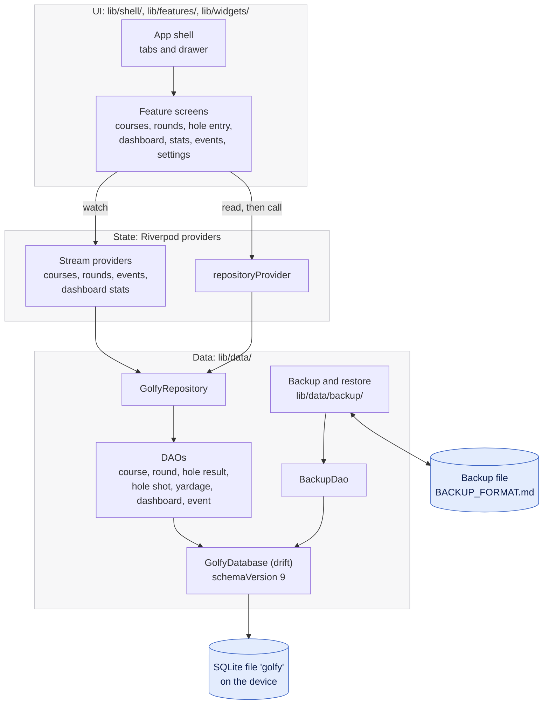
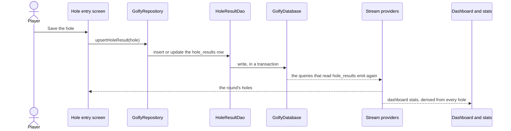
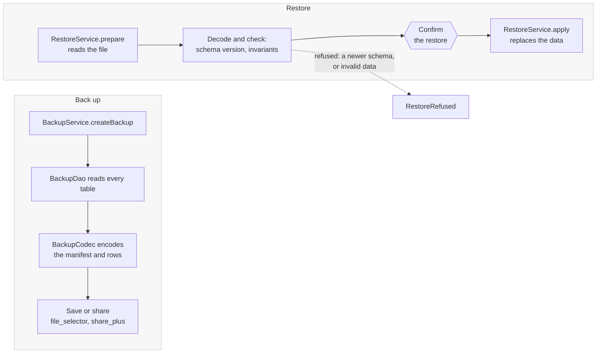
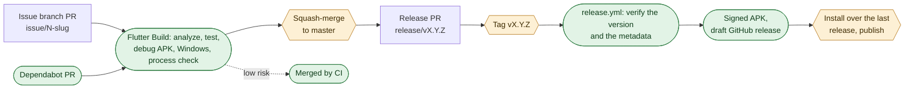

# Architecture

How Golfy fits together: Flutter screens, Riverpod providers, a repository over drift DAOs, and
one SQLite database on the device. Per-hole data is the source of truth, and every statistic is
a query over it, never a stored number. app/README.md has the developer workflow; this page
shows how the parts connect.

## Layers

| Part            | Lives in                                                                            | Responsible for                                                             |
| --------------- | ----------------------------------------------------------------------------------- | --------------------------------------------------------------------------- |
| Shell           | `app/lib/shell/`                                                                    | The tabs and the drawer that every screen sits in                           |
| Feature screens | `app/lib/features/<feature>/`                                                       | One folder per feature; hole entry holds the per-hole capture and its rules |
| Providers       | `app/lib/data/*_provider.dart`                                                      | The database, the repository, and the streams screens watch                 |
| Repository      | `app/lib/data/repository.dart`                                                      | The one API the UI calls, over the DAOs                                     |
| DAOs and tables | `app/lib/data/daos/`, `app/lib/data/tables/`                                        | Queries and table definitions; `*.g.dart` is generated by `build_runner`    |
| Migrations      | `app/lib/data/schema_versions.dart`, `app/drift_schemas/`, `app/lib/data/upgrades/` | Step-by-step schema migrations, one snapshot per version, and data upgrades |
| Backup          | `app/lib/data/backup/`                                                              | Export to a file, and restore from one after validating it                  |

## Saving a hole

Every write goes through the repository, and every screen that shows the data is watching a
stream, so nothing refreshes by hand: drift re-runs the queries a write touches.

## Backup and restore

A backup is a whole history in one file; a restore replaces the database with it, but only
after the file is decoded and checked, and you confirm.

## From a change to a release

